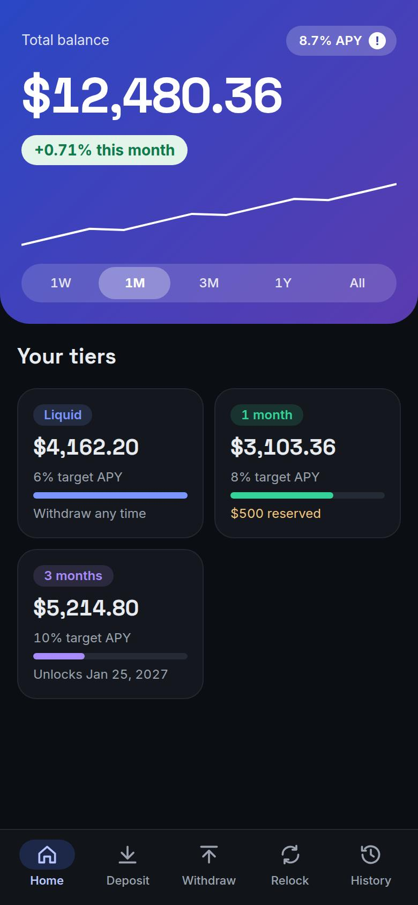
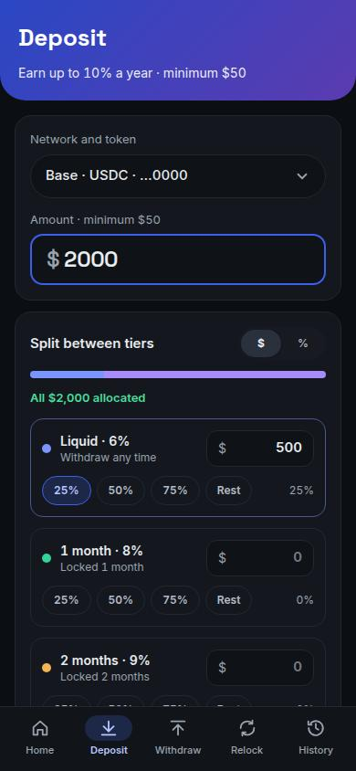
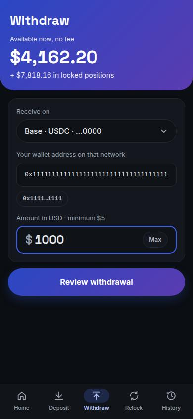
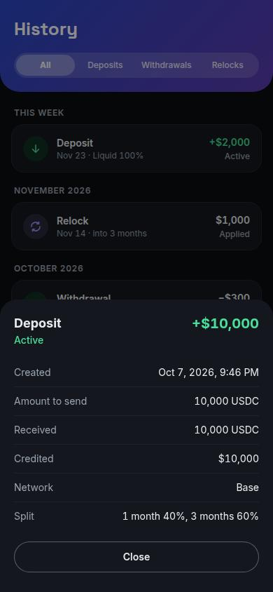
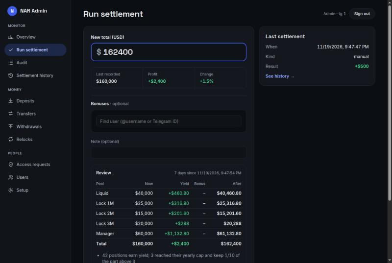

# NAR

[](https://github.com/nzmpi/nar/actions/workflows/ci.yml)
[](LICENSE)

Stablecoin deposit vaults, a ledger, and settlement and withdrawal workflows for a private group. Members use a Telegram Mini App and bot; admins use a web dashboard.

**Try it:** open [@Nar_MiniApp](https://t.me/Nar_MiniApp) in Telegram. Until an admin approves your access request you see a mock Mini App with sample data, so you can click through deposit, withdraw and history without an account or any funds.

> **Testnet only.** It runs on Base Sepolia and Arbitrum Sepolia with test USDC. The contracts and backend are not audited. Do not use real funds. Returns shown in the app are projections, not guarantees.

## What it does

- **Access.** People ask to join from the Mini App. Until an admin approves them, they see a demo with sample data.
- **Deposit vaults.** Each member gets their own vault contract per network, at an address derived from a factory. The backend scans those addresses for USDC and similar stablecoin transfers, matches them to deposit intents, and records them once they are swept to the treasury.
- **Ledger.** Balances are held as shares in pools: a liquid pool, 1, 2 and 3 month lock pools, and a manager pool. Every deposit, settlement, relock and withdrawal is recorded as ledger lines and positions.
- **Settlement.** An admin enters the new total value. Review shows, before anything is recorded, how the change is split across pools, which positions hit their yearly cap, and which locks mature. Confirm records it.
- **Withdrawals and relocks.** Members request withdrawals (with an early-exit fee on locked positions) and moves between lock periods. Admins approve and pay withdrawals by hand; relocks apply at the next settlement.

<p>
  
  
  
  
</p>



All numbers in the screenshots are sample data.

Full spec: [`project-context.json`](project-context.json).

## Design decisions

- **One vault address on every chain.** Vaults are deployed through a factory with CREATE2, so a member's deposit address is derived from their ID and the exact Vault bytecode. `VAULT_CREATION_CODE_HASH` pins that bytecode, so a rebuild cannot silently change addresses.
- **Shares, not balances.** Each pool tracks shares against its value. A settlement only changes the pool value, so thousands of positions update without being rewritten. Profit above a lot's yearly APY cap goes mostly to the manager pool.
- **Preview before confirm.** Settlement Review runs the same code as Confirm, so the admin sees exactly what will be recorded.
- **Admin behind a proxy.** The dashboard's Vercel middleware adds a shared secret and the visitor's IP. The API hides `/admin` without the secret, and sessions only work from the IP and browser that logged in. Logout revokes the session at once.
- **Additive migrations only.** The old container keeps serving during a migration, and rollback is "set the previous image tag". Backups run daily to object storage, with a dead-man's-switch alert.
- **Chains are scanned on demand.** Free RPC plans limit `eth_getLogs`, so "Check vaults" reads balances with Multicall3 first and fetches logs only for vaults that hold tokens.

## Layout

| Folder | What | Stack |
| --- | --- | --- |
| `Backend/` | API, chain scanner, Telegram bot, accounting | Node 22, Fastify, Drizzle, Postgres, viem, grammY |
| `Miniapp/` | Telegram Mini App for users | React, Vite, Tailwind |
| `Admin/` | Admin dashboard (Telegram Login) | React, Vite, Tailwind |
| `Foundry/` | `Factory`, `Vault`, `ProxyBase` contracts | Solidity 0.8.36, Foundry |

## Prerequisites

- Node 22
- Postgres (local or Neon)
- [Foundry](https://getfoundry.sh)
- Submodules: `git submodule update --init --recursive`

## Contracts

```bash
cd Foundry
forge build
forge test
```

The backend derives vault addresses from `Foundry/out/Vault.sol/Vault.json`. Vault addresses depend on the exact creation bytecode, so set `VAULT_CREATION_CODE_HASH` in the backend to pin it.

## Backend

```bash
cd Backend
cp .env.example .env   # fill DATABASE_URL, OWNER_TELEGRAM_ID, BOT_TOKEN, TELEGRAM_CLIENT_SECRET, SESSION_SECRET (32+ chars)
npm ci
npm run db:migrate     # applies drizzle/ migrations, including the pool seed
npm run dev            # http://localhost:3000, health at /health and /health/db
```

- `npm test` runs the accounting and integration checks against in-memory PGlite. No database or `.env` needed.
- `npm run build` compiles to `dist/`; `npm start` runs it.
- `APP_ENV=prod` turns on strict checks: RPC URLs required, `TREASURY_ADDRESSES` required, onchain sweep verification.
- Schema change: edit `src/db/schema.ts`, then `npm run db:generate` and commit the new file in `drizzle/`.

### Docker

Build from the repo root. The image compiles the Vault artifact. It does not run migrations on start: run them as a separate step, after a backup.

```bash
docker build -f Backend/Dockerfile -t nar-backend .
docker run --rm --env-file Backend/.env nar-backend node dist/migrate.js
docker run --env-file Backend/.env -p 3000:3000 nar-backend
```

Server deploy: `deploy/compose.yml` runs the GHCR image behind Caddy (automatic HTTPS). Usage is in the file header; migrations and backups are in `deploy/RUNBOOK.md`.

## Mini App

```bash
cd Miniapp
cp .env.example .env   # VITE_API_URL; add http://localhost:5173 to the backend's CORS_ORIGINS
npm ci
npm run dev            # http://localhost:5173
```

Outside Telegram, paste a real `WebApp.initData` string into `VITE_DEV_INIT_DATA` to test in a browser. Never commit it.

## Admin

```bash
cd Admin
cp .env.example .env
npm ci
npm run dev            # http://localhost:5174
```

On Vercel, set `ADMIN_PROXY_SECRET` and `BACKEND_URL` (see `deploy/RUNBOOK.md`). Login uses Telegram Login. The backend's `ADMIN_ORIGIN` must match the Admin URL, and only the owner and added admins can sign in.

## CI

`.github/workflows/ci.yml` runs on every PR and on pushes to `main`:

- format check (`npm run format` must change nothing) in Backend, Admin and Miniapp
- Backend `tsc` and `npm test`
- Admin and Miniapp `npm run build`
- `forge build` and `forge test`
- backend Docker image build; on `main` it is pushed to `ghcr.io/nzmpi/nar-backend`
